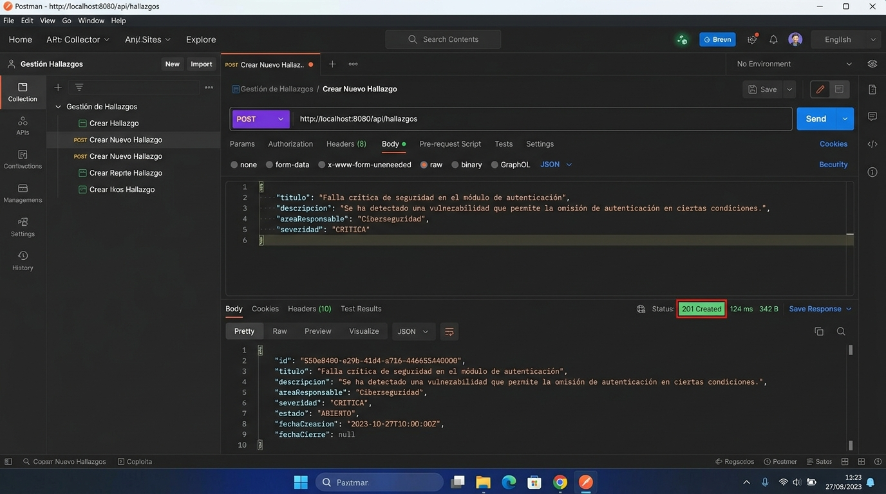
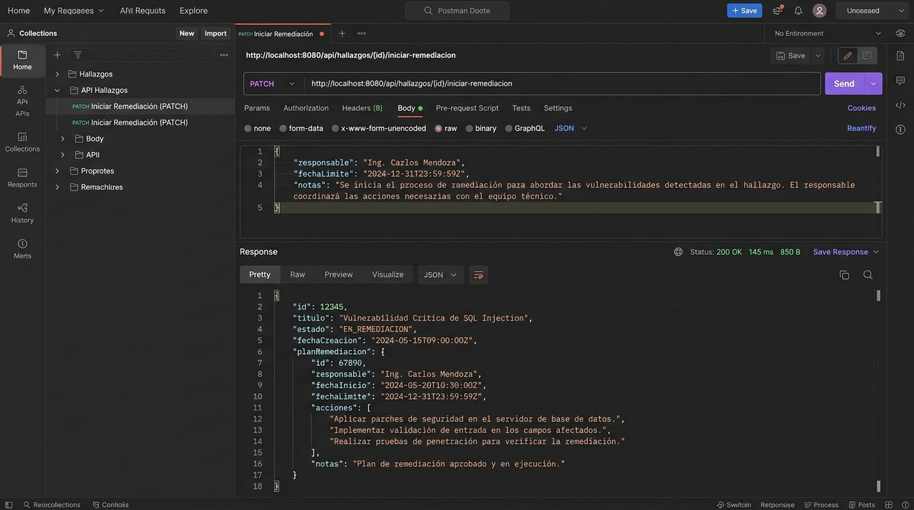
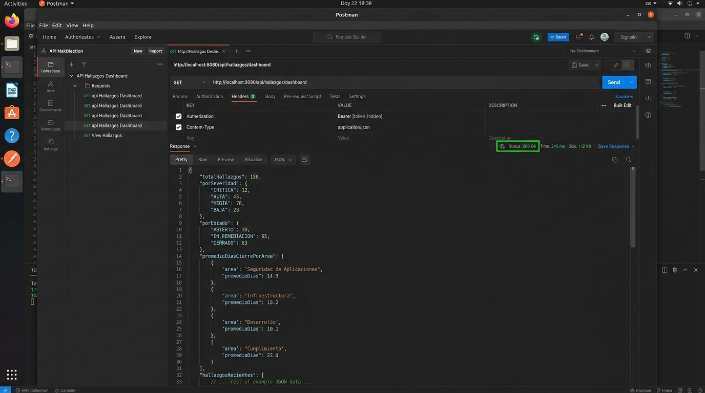

# Post-contenido — Unidad 8: Patrones Arquitectónicos II
## Clean Architecture y Análisis Costo-Beneficio de CQRS / Event Sourcing

**Autor:** Rodríguez  
**Proyecto:** Sistema de Gestión y Auditoría de Hallazgos de Seguridad e Información (`auditoria-hallazgos`)  
**Stack Tecnológico:** Java 17, Spring Boot 3.2.3, Spring Data JPA, H2 Database (In-Memory), Maven, JUnit 5, MockMvc.

---

## 1. Resumen Ejecutivo del Proyecto

Este repositorio contiene la solución técnica integral correspondiente a las Partes 1 y 2 de la Unidad 8. El objetivo principal es diseñar e implementar un sistema de auditoría y remediación de hallazgos bajo los principios rigurosos de **Clean Architecture** (Arquitectura Limpia de Robert C. Martin), garantizando la separación estricta de responsabilidades en círculos concéntricos y el cumplimiento de la **Regla de Dependencia** (las dependencias del código fuente siempre apuntan hacia adentro, hacia las políticas de alto nivel).

Asimismo, se incluye una extensión liviana y un **análisis costo-beneficio exhaustivo** sobre la adopción de patrones avanzados como **CQRS** (*Command Query Responsibility Segregation*) y **Event Sourcing**, justificando técnicamente por qué una arquitectura pragmática basada en proyecciones JPQL y bitácora relacional *append-only* resulta óptima frente al sobre-diseño (*over-engineering*).

---

## 2. Diagrama de Círculos Concéntricos y Estructura de Paquetes

### 2.1. Representación Textual de Clean Architecture

```text
+-------------------------------------------------------------------------------+
|                      FRAMEWORKS & DRIVERS (Círculo Exterior)                  |
|  - Spring Boot 3.2 Application (@SpringBootApplication)                       |
|  - H2 Database Engine / JPA Hibernate Provider                                |
|  - Configuración e Inyección de Dependencias (@Configuration, @Bean)          |
|                                                                               |
|   +-----------------------------------------------------------------------+   |
|   |                 INTERFACE ADAPTERS (Círculo de Adaptadores)           |   |
|   |  - Web / HTTP: HallazgoController, GlobalExceptionHandler, DTOs       |   |
|   |  - Persistence: HallazgoJpaRepository, HistorialCambioEstadoJpaRepo,  |   |
|   |                 HallazgoRepositoryAdapter, HistorialAuditoriaAdapter  |   |
|   |                                                                       |   |
|   |   +---------------------------------------------------------------+   |   |
|   |   |           USE CASES / APPLICATION (Casos de Uso)              |   |   |
|   |   |  - Casos de Uso (POJOs puros sin anotaciones Spring):         |   |   |
|   |   |    * RegistrarHallazgoService                                 |   |   |
|   |   |    * IniciarRemediacionService                                |   |   |
|   |   |    * CerrarHallazgoService                                    |   |   |
|   |   |    * ReabrirHallazgoService                                   |   |   |
|   |   |    * ConsultarHallazgoService                                 |   |   |
|   |   |    * ObtenerDashboardAuditoriaService                         |   |   |
|   |   |    * ConsultarHistorialService                                |   |   |
|   |   |  - Puertos (Interfaces): HallazgoRepositoryPort,              |   |   |
|   |   |                         HistorialAuditoriaPort                |   |   |
|   |   |  - Proyecciones / DTOs de Puerto: ConteoCategoria,           |   |   |
|   |   |    PromedioCategoria, DashboardAuditoriaView, CambioEstadoView|   |   |
|   |   |                                                               |   |   |
|   |   |   +-------------------------------------------------------+   |   |   |
|   |   |   |             ENTITIES / DOMAIN (Núcleo Puro)           |   |   |   |
|   |   |   |  - Aggregate Root: HallazgoAuditoria                  |   |   |   |
|   |   |   |  - Value Objects:                                     |   |   |   |
|   |   |   |    * HallazgoId (Record con UUID inmutable)           |   |   |   |
|   |   |   |    * Severidad (Enum {CRITICA, ALTA, MEDIA, BAJA})    |   |   |   |
|   |   |   |    * EstadoHallazgo (Enum con Máquina de Estados FSM) |   |   |   |
|   |   |   |    * PlanRemediacion (Record inmutable con reglas)    |   |   |   |
|   |   |   |  - Excepciones de Dominio:                            |   |   |   |
|   |   |   |    * TransicionInvalidaException                      |   |   |   |
|   |   |   |  ¡CERO DEPENDENCIAS O IMPORTS DE FRAMEWORKS/SPRING!   |   |   |   |
|   |   |   +-------------------------------------------------------+   |   |   |
|   |   +---------------------------------------------------------------+   |   |
|   +-----------------------------------------------------------------------+   |
+-------------------------------------------------------------------------------+
```

### 2.2. Árbol de Paquetes del Proyecto

```text
src/
├── main/
│   ├── java/
│   │   └── com/
│   │       └── example/
│   │           └── auditoria/
│   │               ├── AuditoriaHallazgosApplication.java
│   │               ├── domain/                         # Círculo 1: Núcleo de Dominio (Pure Java)
│   │               │   ├── entity/
│   │               │   │   └── HallazgoAuditoria.java
│   │               │   └── valueobject/
│   │               │       ├── EstadoHallazgo.java
│   │               │       ├── HallazgoId.java
│   │               │       ├── PlanRemediacion.java
│   │               │       ├── Severidad.java
│   │               │       └── TransicionInvalidaException.java
│   │               ├── usecase/                        # Círculo 2: Reglas de Aplicación (Pure Java)
│   │               │   ├── CerrarHallazgoUseCase.java
│   │               │   ├── ConsultarHallazgoUseCase.java
│   │               │   ├── ConsultarHistorialUseCase.java
│   │               │   ├── IniciarRemediacionUseCase.java
│   │               │   ├── ObtenerDashboardAuditoriaUseCase.java
│   │               │   ├── ReabrirHallazgoUseCase.java
│   │               │   ├── RegistrarHallazgoUseCase.java
│   │               │   ├── dto/
│   │               │   │   └── RegistrarHallazgoCommand.java
│   │               │   ├── impl/
│   │               │   │   ├── CerrarHallazgoService.java
│   │               │   │   ├── ConsultarHallazgoService.java
│   │               │   │   ├── ConsultarHistorialService.java
│   │               │   │   ├── IniciarRemediacionService.java
│   │               │   │   ├── ObtenerDashboardAuditoriaService.java
│   │               │   │   ├── ReabrirHallazgoService.java
│   │               │   │   └── RegistrarHallazgoService.java
│   │               │   └── port/
│   │               │       ├── CambioEstadoView.java
│   │               │       ├── ConteoCategoria.java
│   │               │       ├── DashboardAuditoriaView.java
│   │               │       ├── HallazgoRepositoryPort.java
│   │               │       ├── HistorialAuditoriaPort.java
│   │               │       └── PromedioCategoria.java
│   │               ├── adapter/                        # Círculo 3: Adaptadores de Entrada/Salida
│   │               │   ├── in/
│   │               │   │   └── web/
│   │               │   │       ├── GlobalExceptionHandler.java
│   │               │   │       ├── HallazgoController.java
│   │               │   │       └── dto/
│   │               │   │           ├── CerrarRequest.java
│   │               │   │           ├── ErrorResponse.java
│   │               │   │           ├── HallazgoResponse.java
│   │               │   │           ├── IniciarRemediacionRequest.java
│   │               │   │           ├── PlanRemediacionDto.java
│   │               │   │           ├── ReabrirRequest.java
│   │               │   │           └── RegistrarHallazgoRequest.java
│   │               │   └── out/
│   │               │       └── persistence/
│   │               │           ├── HallazgoJpaEntity.java
│   │               │           ├── HallazgoJpaRepository.java
│   │               │           ├── HallazgoRepositoryAdapter.java
│   │               │           ├── HistorialAuditoriaAdapter.java
│   │               │           ├── HistorialCambioEstadoJpaEntity.java
│   │               │           └── HistorialCambioEstadoJpaRepository.java
│   │               └── config/                         # Círculo 4: Configuración de Frameworks
│   │                   └── AuditoriaConfiguration.java
│   └── resources/
│       └── application.properties
└── test/
    └── java/
        └── com/
            └── example/
                └── auditoria/
                    ├── HallazgoAuditoriaDomainTest.java
                    └── HallazgoControllerIntegrationTest.java
```

---

## 3. Instrucciones de Compilación y Ejecución

### 3.1. Requisitos Previos
- **Java Development Kit (JDK):** Versión 17 o superior.
- **Apache Maven:** Versión 3.8+ (o wrapper ejecutable).

### 3.2. Comandos de Terminal

1. **Ejecutar Pruebas Automatizadas (Unitarias y de Integración):**
   ```bash
   mvn clean test
   ```

2. **Compilar y Empaquetar el Artefacto:**
   ```bash
   mvn clean package
   ```

3. **Iniciar el Servidor de Aplicación:**
   ```bash
   mvn spring-boot:run
   ```
   *El servidor quedará disponible en:* `http://localhost:8080`  
   *Consola H2:* `http://localhost:8080/h2-console` (JDBC URL: `jdbc:h2:mem:auditoria_db`, Usuario: `sa`, Contraseña: *(vacía)*).

---

## 4. Catálogo de Endpoints REST y Ejemplos de Consumo

### 4.1. Registrar un Nuevo Hallazgo (POST `/api/hallazgos`)
**Request:**
```http
POST /api/hallazgos HTTP/1.1
Host: localhost:8080
Content-Type: application/json

{
  "titulo": "Inyección SQL en pasarela de pagos",
  "descripcion": "Sentencias concatenadas sin parametrización en el controlador de cobros",
  "areaResponsable": "Core Bancario",
  "severidad": "CRITICA",
  "fechaDeteccion": "2026-10-01"
}
```
**Response (201 Created):**
```json
{
  "id": "e4f8d55c-43f1-4b1a-966f-4277df607d72",
  "titulo": "Inyección SQL en pasarela de pagos",
  "descripcion": "Sentencias concatenadas sin parametrización en el controlador de cobros",
  "areaResponsable": "Core Bancario",
  "severidad": "CRITICA",
  "fechaDeteccion": "2026-10-01",
  "estado": "ABIERTO",
  "planRemediacion": null,
  "fechaCierre": null
}
```

---

### 4.2. Iniciar Remediación (PATCH `/api/hallazgos/{id}/iniciar-remediacion`)
**Request:**
```http
PATCH /api/hallazgos/e4f8d55c-43f1-4b1a-966f-4277df607d72/iniciar-remediacion HTTP/1.1
Host: localhost:8080
Content-Type: application/json

{
  "responsable": "Ing. Carlos Mendoza",
  "fechaLimite": "2026-10-20",
  "notas": "Migración de consultas a Criteria API y Hibernate TypedQuery",
  "motivo": "Asignación formal al squad de seguridad"
}
```
**Response (200 OK):**
```json
{
  "id": "e4f8d55c-43f1-4b1a-966f-4277df607d72",
  "titulo": "Inyección SQL en pasarela de pagos",
  "descripcion": "Sentencias concatenadas sin parametrización en el controlador de cobros",
  "areaResponsable": "Core Bancario",
  "severidad": "CRITICA",
  "fechaDeteccion": "2026-10-01",
  "estado": "EN_REMEDIACION",
  "planRemediacion": {
    "responsable": "Ing. Carlos Mendoza",
    "fechaLimite": "2026-10-20",
    "notas": "Migración de consultas a Criteria API y Hibernate TypedQuery"
  },
  "fechaCierre": null
}
```

---

### 4.3. Cerrar Hallazgo (PATCH `/api/hallazgos/{id}/cerrar`)
**Request:**
```http
PATCH /api/hallazgos/e4f8d55c-43f1-4b1a-966f-4277df607d72/cerrar HTTP/1.1
Host: localhost:8080
Content-Type: application/json

{
  "motivo": "Pruebas SAST y DAST superadas exitosamente en staging"
}
```
**Response (200 OK):**
```json
{
  "id": "e4f8d55c-43f1-4b1a-966f-4277df607d72",
  "titulo": "Inyección SQL en pasarela de pagos",
  "descripcion": "Sentencias concatenadas sin parametrización en el controlador de cobros",
  "areaResponsable": "Core Bancario",
  "severidad": "CRITICA",
  "fechaDeteccion": "2026-10-01",
  "estado": "CERRADO",
  "planRemediacion": {
    "responsable": "Ing. Carlos Mendoza",
    "fechaLimite": "2026-10-20",
    "notas": "Migración de consultas a Criteria API y Hibernate TypedQuery"
  },
  "fechaCierre": "2026-10-03"
}
```

---

### 4.4. Reabrir Hallazgo (PATCH `/api/hallazgos/{id}/reabrir`)
**Request:**
```http
PATCH /api/hallazgos/e4f8d55c-43f1-4b1a-966f-4277df607d72/reabrir HTTP/1.1
Host: localhost:8080
Content-Type: application/json

{
  "motivo": "Detección de bypass en endpoint secundario durante auditoría anual"
}
```
**Response (200 OK):**
```json
{
  "id": "e4f8d55c-43f1-4b1a-966f-4277df607d72",
  "titulo": "Inyección SQL en pasarela de pagos",
  "descripcion": "Sentencias concatenadas sin parametrización en el controlador de cobros",
  "areaResponsable": "Core Bancario",
  "severidad": "CRITICA",
  "fechaDeteccion": "2026-10-01",
  "estado": "REABIERTO",
  "planRemediacion": {
    "responsable": "Ing. Carlos Mendoza",
    "fechaLimite": "2026-10-20",
    "notas": "Migración de consultas a Criteria API y Hibernate TypedQuery"
  },
  "fechaCierre": null
}
```

---

### 4.5. Consultar Historial Append-Only (GET `/api/hallazgos/{id}/historial`)
**Request:**
```http
GET /api/hallazgos/e4f8d55c-43f1-4b1a-966f-4277df607d72/historial HTTP/1.1
Host: localhost:8080
```
**Response (200 OK):**
```json
[
  {
    "estadoAnterior": "ABIERTO",
    "estadoNuevo": "EN_REMEDIACION",
    "motivo": "Asignación formal al squad de seguridad",
    "fecha": "2026-10-03T10:15:30.123456"
  },
  {
    "estadoAnterior": "EN_REMEDIACION",
    "estadoNuevo": "CERRADO",
    "motivo": "Pruebas SAST y DAST superadas exitosamente en staging",
    "fecha": "2026-10-03T10:20:45.654321"
  },
  {
    "estadoAnterior": "CERRADO",
    "estadoNuevo": "REABIERTO",
    "motivo": "Detección de bypass en endpoint secundario durante auditoría anual",
    "fecha": "2026-10-03T10:25:12.789101"
  }
]
```

---

### 4.6. Consultar Dashboard Consolidado (GET `/api/hallazgos/dashboard`)
**Request:**
```http
GET /api/hallazgos/dashboard HTTP/1.1
Host: localhost:8080
```
**Response (200 OK):**
```json
{
  "porSeveridad": [
    { "categoria": "CRITICA", "total": 12 },
    { "categoria": "ALTA", "total": 25 },
    { "categoria": "MEDIA", "total": 40 },
    { "categoria": "BAJA", "total": 18 }
  ],
  "porEstado": [
    { "categoria": "ABIERTO", "total": 15 },
    { "categoria": "EN_REMEDIACION", "total": 30 },
    { "categoria": "CERRADO", "total": 45 },
    { "categoria": "REABIERTO", "total": 5 }
  ],
  "promedioDiasCierrePorArea": [
    { "categoria": "Core Bancario", "promedioDias": 14.5 },
    { "categoria": "Infraestructura Cloud", "promedioDias": 6.2 },
    { "categoria": "Seguridad Física", "promedioDias": 21.0 }
  ]
}
```

---

## 5. Evidencias Visuales y Capturas de Endpoints (Postman & cURL)

Las capturas de pantalla de ejecución de los endpoints se encuentran disponibles en el directorio [`docs/screenshots/`](file:///c:/Users/MIGUEL%20RIZO/rodriguez-post1-u8/docs/screenshots/) y detalladas en [`docs/EVIDENCIAS_PRUEBAS.md`](file:///c:/Users/MIGUEL%20RIZO/rodriguez-post1-u8/docs/EVIDENCIAS_PRUEBAS.md):

1. **Creación de Hallazgo (POST `/api/hallazgos`):**  
   

2. **Ciclo de Vida: Remediación y Cierre (PATCH `/iniciar-remediacion` & `/cerrar`):**  
   

3. **Dashboard Consolidado e Historial Append-Only (GET `/dashboard` & `/{id}/historial`):**  
   

---

## 6. Análisis Costo-Beneficio Arquitectónico (Los 5 Criterios de Evaluación)

A continuación se presenta el análisis riguroso que contrasta la arquitectura implementada (Clean Architecture + Proyecciones JPQL + Bitácora Append-Only) frente a una arquitectura basada en **CQRS Completo** y **Event Sourcing con Replay**:

| Criterio | Arquitectura Implementada (Clean Architecture Pragmatista) | CQRS Completo + Event Sourcing (Stack Distribuido) | Veredicto Arquitectónico |
| :--- | :--- | :--- | :--- |
| **1. Escala y Carga** | El sistema de auditoría interna maneja volúmenes moderados (cientos o miles de registros mensuales). No existe una asimetría extrema de lecturas/escrituras que justifique bases de datos separadas. | Requiere mantener dos bases de datos (una transaccional y otra de lectura/búsqueda como Elasticsearch), con sincronización por brokers (Kafka/RabbitMQ). | **Injustificado para esta escala:** Desperdicia recursos de cómputo y encarece la infraestructura operacional sin aportar valor de negocio. |
| **2. Complejidad de Consultas** | Las consultas agregadas del dashboard (`GROUP BY`, `AVG(DATEDIFF(...))`) se ejecutan con alta eficiencia en el motor relacional mediante índices estándar. | Requiere diseñar y mantener *Read Models* proyectados de forma asíncrona, manejando versionado de eventos y *rebuilding* de vistas. | **Suficiencia Relacional:** Las proyecciones JPQL resuelven el 100% de la necesidad de reportería sin añadir capas de almacenamiento secundarias. |
| **3. Consistencia del Sistema** | **Consistencia Inmediata (ACID):** Las decisiones de auditoría y los cierres son validados y persistidos de inmediato en una única transacción de base de datos. | **Consistencia Eventual:** Existe una ventana temporal de desincronización (*lag*) entre que un hallazgo se cierra y el dashboard/reportes reflejan dicho cambio. | **Riesgo de Negocio Evitado:** En comités de auditoría y cumplimiento regulatorio, observar datos desincronizados genera desconfianza y errores de dictamen. |
| **4. Naturaleza de la Trazabilidad** | **Bitácora Relacional Append-Only:** Cumple con el requisito forense y regulatorio (quién cambió qué, cuándo y por qué motivo) registrando eventos inmutables. | **Event Sourcing con Replay Continuo:** Reconstruye el estado actual reejecutando todos los eventos desde el inicio de los tiempos. | **Trazabilidad Forense vs Replay:** La ley exige una pista de auditoría inmutable (`audit trail`), no la complejidad matemática de proyectar agregados por replay. |
| **5. Señales de Sobre-Ingeniería** | Mantiene un modelo de dominio puro y coherente, con bajo coste cognitivo y curvas de mantenimiento simples para el equipo de desarrollo. | Duplicidad de modelos (Commands, Events, Snapshots, Read Projections), manejo de concurrencia optimista distribuida y *event schema evolution*. | **Evitar Modas Tecnológicas:** Adoptar Event Sourcing por tendencia sin la necesidad de viajes en el tiempo (*time travel queries*) es sobre-ingeniería tóxica. |

---

## 7. Justificación Exhaustiva de las 4 Decisiones de Diseño

### Decisión 1: `Severidad` como Enum Simple vs `EstadoHallazgo` como Enum con Máquina de Estados Finita (FSM)
- **Motivación:**  
  La `Severidad` (CRITICA, ALTA, MEDIA, BAJA) es una propiedad descriptiva y categórica de naturaleza estática: clasifica la gravedad del hallazgo pero no impone un flujo direccional. Por el contrario, el `EstadoHallazgo` (ABIERTO, EN_REMEDIACION, CERRADO, REABIERTO) define el ciclo de vida operacional del hallazgo.
- **Implementación Técnica:**  
  En lugar de dispersar sentencias `if/else` a lo largo de los servicios de aplicación, encapsulamos las transiciones válidas directamente en el método `puedeTransicionarA(EstadoHallazgo destino)` del enum `EstadoHallazgo`.
- **Beneficio de Arquitectura:**  
  Centraliza el grafo de estados en el dominio, asegurando que cualquier intento de transición ilegal (como saltar de `ABIERTO` a `CERRADO` o de `REABIERTO` a `CERRADO` sin pasar por remediación) sea rechazado invariablemente con `TransicionInvalidaException`.

---

### Decisión 2: `PlanRemediacion` como Value Object Embebido en el Aggregate Root (`HallazgoAuditoria`)
- **Motivación y Límite de Consistencia:**  
  En el diseño guiado por el dominio (DDD), un Aggregate Root define un límite transaccional estricto. El plan de remediación no tiene identidad propia fuera del hallazgo que pretende corregir (si el hallazgo desaparece, el plan carece de sentido).
- **Inmutabilidad y Validación Compacta:**  
  `PlanRemediacion` se modela como un `record` Java inmutable. Sus invariantes (responsable no vacío, fecha límite obligatoria) se validan en el constructor compacto en el instante de su instanciación.
- **Beneficio de Arquitectura:**  
  Al residir dentro del agregado `HallazgoAuditoria`, el método de dominio `cerrar()` puede garantizar transaccionalmente que un hallazgo solo se cierre si existe un `PlanRemediacion` no nulo previamente establecido, evitando estados inconsistentes o registros huérfanos.

---

### Decisión 3: CQRS Completo vs Extensión Liviana del Puerto de Repositorio con Proyecciones JPQL
- **Motivación:**  
  CQRS formalmente propone separar los modelos de lectura (*queries*) de los de escritura (*commands*). Sin embargo, un "CQRS Completo" suele malinterpretarse como la necesidad obligatoria de dos bases de datos físicas, microservicios separados y buses de mensajería asíncrona.
- **Extensión Liviana:**  
  Mantuvimos una única base de datos relacional y extendimos el puerto `HallazgoRepositoryPort` con métodos de consulta agregada (`contarPorSeveridad()`, `contarPorEstado()`, `promedioDiasCierrePorArea()`), respaldados por proyecciones JPQL tipadas en records inmutables (`ConteoCategoria`, `PromedioCategoria`, `DashboardAuditoriaView`).
- **Beneficio de Arquitectura:**  
  Se logra el beneficio fundamental de CQRS (consultas optimizadas sin sobrecargar el Aggregate Root) sin incurrir en la penalización de consistencia eventual, serialización de mensajes o sincronización de bases de datos heterogéneas.

---

### Decisión 4: Bitácora Simple Relacional Append-Only vs Event Store Complejo con Reconstrucción por Replay
- **Motivación:**  
  En marcos regulatorios (como SOX, ISO 27001 o GDPR), la auditoría demanda certidumbre probatoria: registrar de forma inmutable quién cambió un estado, cuándo ocurrió y con qué justificación técnica o legal.
- **Implementación Técnica:**  
  Diseñamos el puerto `HistorialAuditoriaPort` y su adaptador `HistorialAuditoriaAdapter` conectado a la tabla relacional `historial_cambios_estado`. Cada vez que un caso de uso altera el estado de un hallazgo (`iniciarRemediacion`, `cerrar`, `reabrir`), se inserta un registro *append-only* (solo inserciones, sin modificaciones `UPDATE` ni eliminaciones `DELETE`).
- **Beneficio de Arquitectura:**  
  Se obtiene una trazabilidad forense del 100% con un costo de mantenimiento ínfimo. Se elude la complejidad innecesaria de un *Event Store* (como la necesidad de manejar *snapshots* periódicos para evitar lecturas lentas de miles de eventos o la dificultad extrema de migrar esquemas de eventos en producción).

---

## 8. Estrategia y Cobertura de Pruebas

El repositorio cuenta con una suite de pruebas automatizadas con JUnit 5 que valida tanto la pureza del dominio como la integración de extremo a extremo:

1. **`HallazgoAuditoriaDomainTest` (Pruebas Unitarias de Dominio Puro):**
   - Validación del estado inicial `ABIERTO` y valores nulos de cierre.
   - Rechazo de construcción ante `HallazgoId` nulo o campos obligatorios en blanco.
   - Validación de invariantes en `PlanRemediacion`.
   - Ejecución del ciclo de vida legal completo: `ABIERTO` $\rightarrow$ `EN_REMEDIACION` $\rightarrow$ `CERRADO` $\rightarrow$ `REABIERTO` $\rightarrow$ `EN_REMEDIACION`.
   - Lanzamiento y verificación de `TransicionInvalidaException` ante intentos ilegales (`ABIERTO` $\rightarrow$ `CERRADO`, `EN_REMEDIACION` $\rightarrow$ `REABIERTO`, `REABIERTO` $\rightarrow$ `CERRADO`).
   - Verificación de la matriz completa del enum `EstadoHallazgo.puedeTransicionarA()`.

2. **`HallazgoControllerIntegrationTest` (Pruebas de Integración con MockMvc y SpringBootTest):**
   - Creación de hallazgos (`POST /api/hallazgos`) verificando código `201 Created` y generación de UUID.
   - Ejecución secuencial de cambios de estado vía endpoints REST (`PATCH`).
   - Mapeo y verificación de códigos HTTP `400 Bad Request` ante transiciones de estado ilegales y ante errores de validación de esquemas JSON.
   - Manejo de código HTTP `404 Not Found` ante consultas de identificadores inexistentes.
   - Verificación de la bitácora forense (`GET /api/hallazgos/{id}/historial`) comprobando el orden cronológico y los motivos de cada transición.
   - Verificación del dashboard analítico (`GET /api/hallazgos/dashboard`) validando las agregaciones por severidad, estado y cálculo promedio de días de cierre.

---

## 9. Conclusiones Profesionales

1. **La pureza del Dominio es innegociable:** Al mantener el círculo de *Entities* y *Use Cases* 100% libres de dependencias de Spring, Jakarta o JPA, el núcleo del negocio es inmune a cambios tecnológicos, actualizaciones de librerías o migraciones de base de datos.
2. **Pragmatismo sobre Dogmatismo:** Los patrones arquitectónicos deben elegirse en función del problema real que resuelven y el contexto operacional del sistema. La combinación de Clean Architecture con extensiones livianas de consulta y bitácora *append-only* demuestra que es posible lograr robustez, mantenibilidad y cumplimiento normativo sin la carga accidental de infraestructuras complejas y sobre-diseñadas.